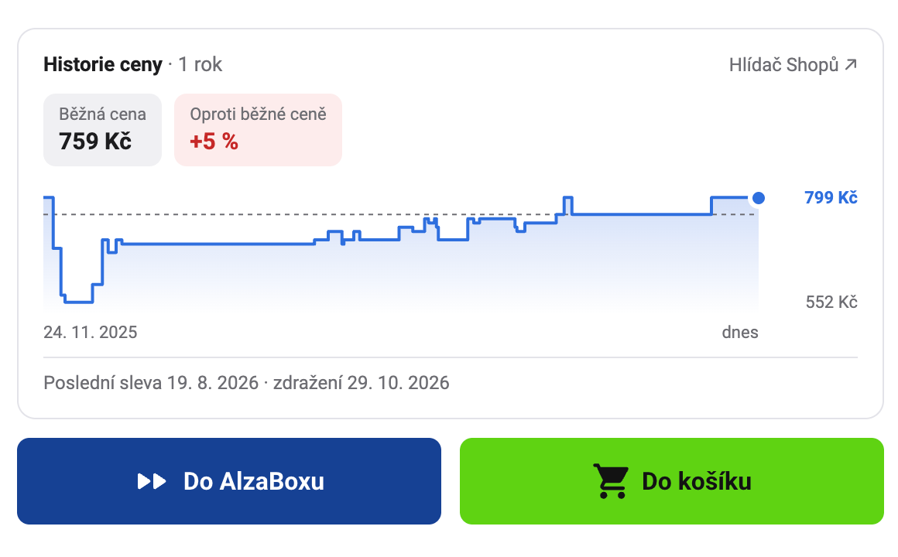
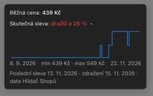

# Hlídač cen

Userscript, který na stránce produktu v českých a slovenských e‑shopech ukáže historii ceny za poslední rok: běžnou cenu, skutečnou slevu a graf. Data bere z veřejného API [Hlídače Shopů](https://www.hlidacshopu.cz/).

Je to lehká náhrada rozšíření Hlídač Shopů. Má pár kilobajtů, nic nepřidává na stránky, kde není produkt, a na Alze nezasekává načítání.

| Alza (vedle ceny) | Ostatní obchody (panel vlevo dole) |
| --- | --- |
|  |  |

## Co ukazuje

- **Běžnou cenu** podle Hlídače Shopů.
- **Skutečnou slevu** proti běžné ceně. Když je produkt naopak dražší, napíše „dražší o X %“. Pokud obchod uvádí vlastní slevu, ukáže ji vedle pro srovnání.
- **Graf ceny** za posledních 365 dní s nejnižší a nejvyšší cenou.
- Datum poslední slevy a posledního zdražení.

Na Alze se box vloží přímo vedle ceny. V ostatních obchodech je to plovoucí panel vlevo dole, který jde sbalit šipkou ▾. Tmavý režim se řídí systémem. Na stránkách bez produktu, nebo když Hlídač Shopů produkt nezná, se nezobrazí nic.

## Obchody

4camping, AAA Auto, Albert, Alza, Autoesa, BENU, Billa, Datart, dm, EVA, Globus, Grizly, Hornbach, IKEA (CZ), Tesco, Kaufland, Knihy Dobrovský, Košík, Lékárna.cz, Lidl, Mall, Megapixel, Mironet, Mountfield, Notino, OBI, OKAY, Pilulka, Rohlík, Tchibo, Teta drogerie, TS Bohemia. Kde existuje, tak i slovenská verze.

## Instalace

1. Nainstalujte si do prohlížeče správce userscriptů:
   - **Safari** (Mac, iPhone, iPad): [Userscripts](https://apps.apple.com/app/userscripts/id1463298887). Zapněte rozšíření v Safari → Nastavení → Rozšíření a povolte ho pro všechny weby.
   - **Chrome, Edge, Brave**: [Tampermonkey](https://www.tampermonkey.net/) nebo [Violentmonkey](https://violentmonkey.github.io/). V Chromu navíc v podrobnostech rozšíření (`chrome://extensions`) zapněte **Povolit uživatelské skripty**.
   - **Firefox**: [Tampermonkey](https://www.tampermonkey.net/) nebo [Violentmonkey](https://violentmonkey.github.io/).
2. Otevřete skript na [Greasy Fork](https://greasyfork.org/cs/scripts/606886-hl%C3%ADda%C4%8D-cen) a klikněte na **Nainstalovat skript**, nebo ho otevřete přímo z GitHubu:

   https://raw.githubusercontent.com/kasparek-net/hlidac-cen/main/hlidac-cen.user.js

3. Potvrďte instalaci. V Safari otevřete na té stránce nabídku rozšíření Userscripts a klikněte na **Install**.
4. Správce se může zeptat na přístup k `api.hlidacshopu.cz`. Povolte ho, odtud skript bere data.

Pokud máte nainstalované rozšíření Hlídač Shopů, vypněte ho, ať se na stránce neukazují dva grafy.

## Soukromí

Skript posílá na `api.hlidacshopu.cz` jen adresu stránky v podporovaném obchodě, a to bez parametrů za otazníkem (hledané výrazy, sledovací kódy apod. se neposílají). Výjimkou je parametr `dq` na Alze, který u některých odkazů určuje produkt. Nic dalšího skript neodesílá a nic neukládá.

## Poznámka

Projekt není spojený s Hlídačem Shopů ani s TopMonks. Používá jejich veřejné API, data a výpočet běžné ceny a skutečné slevy jsou jejich. Pokud se vám to hodí, podpořte [Hlídač Shopů](https://www.hlidacshopu.cz/).

## Licence

MIT
